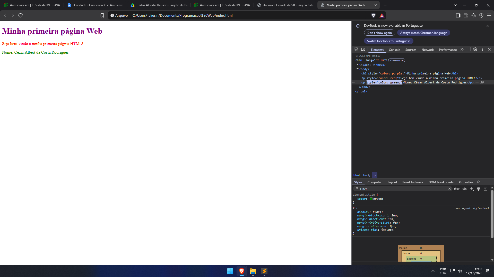

# Minha primeira página Web
Nome: Cézar Albert da Costa Rodrigues

## Sobre a atividade

Esta é minha primeira página desenvolvida na disciplina
Programação Web.

## Tecnologias utilizadas

- HTML
- Git
- GitHub

##Caputra de tela DEVTOOLS

